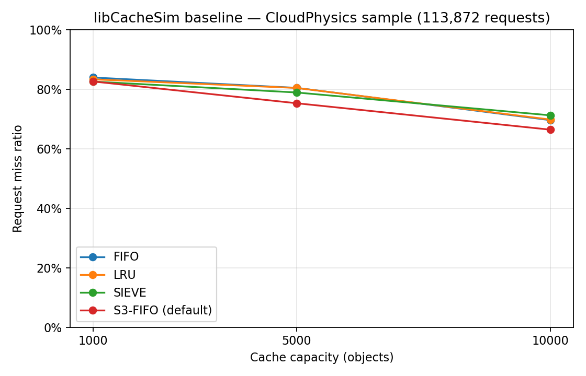

# Tuning S3-FIFO Cache Eviction — Task 1 baseline

The additional public trace, workload analysis, and Task 2 results are documented
in [TASK2.md](TASK2.md). The original Task 1 baseline below is preserved.

Task 1 is complete: build the existing libCacheSim simulator and compare FIFO,
LRU, SIEVE, and default S3-FIFO on one bundled sample at three cache capacities.
No eviction policy source was changed and no S3-FIFO tuning was performed.

## Source and trace

Official repository: <https://github.com/1a1a11a/libCacheSim>.
The experiment pins commit `40fb623af3793fbe5736bda9a35488d0f366ef6e`
(version file: 0.3.5). The clone is in `vendor/libCacheSim`, excluded from this
project's Git history; reproduction requires downloading it.

The bundled `data/cloudPhysicsIO.txt` sample is 1,007,325 bytes, with 113,872
requests and 48,974 distinct object IDs. It is a supported `txt` trace: one object
ID per line, no header, timestamps, or object sizes. Its SHA-256 is
`1b48334535801ae862d53e9d7623467186eeb93054462b38021fef273cab0439`.
The upstream [CLI guide](https://github.com/1a1a11a/libCacheSim/blob/40fb623af3793fbe5736bda9a35488d0f366ef6e/doc/quickstart_cachesim.md)
documents this exact sample and format. We use the entire file, unmodified.

## Reproduce

Run commands from this project's root. Network access is required for Git and
dependency downloads. The tested environment is Ubuntu 26.04.1, x86-64,
GCC/G++ 15.2.0, GNU Make, pkg-config 2.5.1, CMake 4.2.3, GLib 2.88.0,
Zstandard 1.5.7, Python 3.14.4, and matplotlib 3.10.7.

### 1. Obtain the pinned official source

```bash
git clone https://github.com/1a1a11a/libCacheSim.git vendor/libCacheSim
git -C vendor/libCacheSim checkout --detach 40fb623af3793fbe5736bda9a35488d0f366ef6e
git -C vendor/libCacheSim rev-parse HEAD
git -C vendor/libCacheSim status --short
```

The initial clone already resolved to the pinned commit. The runner rejects a
different commit, a changed checkout, or a changed trace.

### 2. Dependencies

On an ordinary Ubuntu machine with sudo, the system-package route is:

```bash
sudo apt-get update
sudo apt-get install -y build-essential pkg-config cmake libglib2.0-dev libzstd-dev python3-matplotlib
```

That route was **not completed here**: `sudo -n apt-get update` returned
`sudo: interactive authentication is required`. Instead, we downloaded and
extracted matching Ubuntu packages into `.deps/root` without installing them
system-wide. This is the route actually used in this workspace:

```bash
bash scripts/install_local_deps.sh
source scripts/env.sh
```

The script executes `apt-get download` with every exact `package=version` in
`scripts/ubuntu-deps.lock`, verifies `results/dependency-packages.sha256`, and
extracts each archive using `dpkg-deb -x`. The initial downloads were these
batches (followed by extraction):

```bash
mkdir -p .deps/packages .deps/root
cd .deps/packages
apt-get download cmake cmake-data libjsoncpp26 librhash1 libglib2.0-dev libzstd-dev
apt-get download libgio-2.0-dev libglib2.0-dev-bin libpcre2-dev
apt-get download libglib2.0-0t64 libzstd1 libsysprof-capture-4-dev
cd ../..
for package in .deps/packages/*.deb; do dpkg-deb -x "$package" .deps/root; done
```

This local fallback targets Ubuntu 26.04 amd64 and relies on its existing runtime
libraries, compiler, Make, pkg-config, Python, and matplotlib. It is not a portable
Linux distribution bundle. If locked packages disappear from the configured APT
repositories, downloading fails explicitly; use the documented system route or
recover those exact packages from an Ubuntu archive. Do not replace the lock
silently. The Python plotting dependency was already installed.

`scripts/env.sh` selects these local tools/libraries when present and gives
matplotlib a writable cache directory under `/tmp`. Source it in every new shell
before running experiments. With system-installed dependencies and no `.deps`,
the same build and experiment commands use the system tools.

### 3. Build and smoke test

```bash
bash scripts/build.sh
```

The script runs these commands and saves configuration/build/help logs:

```bash
cmake -S vendor/libCacheSim -B build -DCMAKE_BUILD_TYPE=Release -DCMAKE_C_STANDARD=17 '-DCMAKE_CXX_FLAGS=-include cstdint' -DENABLE_TESTS=OFF
cmake --build build --target cachesim -j 2
build/bin/cachesim --help
```

Only the simulator target and required libraries are built; installation into
`/usr/local` is unnecessary. Upstream's full test suite is disabled for this
baseline; verification consists of the CLI help check and actual trace replays.

Two initial build attempts failed with this new compiler. The first omitted
`CMAKE_C_STANDARD=17` and hit a discarded-const error in `utils/mystr.c` under
GCC 15's default C23 mode. The second used C17 but hit missing `uint32_t`/
`uint64_t` declarations in the bundled C++ `robin_hood.h` header. Explicit C17
and pre-including standard `<cstdint>` resolved both without editing upstream
files or suppressing warnings. The failed build logs are retained.
Optional TCMalloc was unavailable; upstream configured successfully with the
standard allocator. No required algorithm or trace was unavailable.

The successful initial smoke test was:

```bash
source scripts/env.sh
build/bin/cachesim vendor/libCacheSim/data/cloudPhysicsIO.txt txt s3fifo 1000 --ignore-obj-size 1 --num-thread 1 --warmup-sec -1 --consider-obj-metadata 0 --print-head-req 0 --output results/logs/smoke-result.txt > results/logs/smoke.log 2>&1
```

### 4. Run all 12 experiments and plot

```bash
source scripts/env.sh
python3 scripts/run_baseline.py
python3 scripts/plot_baseline.py
```

`results/commands.txt` contains every exact simulator invocation. Each algorithm
runs in a fresh simulator process at 1,000, 5,000, and 10,000 objects, roughly
2.0%, 10.2%, and 20.4% of the distinct-object working set. These are object
capacities, **not bytes**: `--ignore-obj-size 1` makes each request size one.
Each run starts empty, uses the complete trace with no warmup (`--warmup-sec -1`),
no sampling, no admission filter or prefetching, no TTL, no object metadata
charge, one thread, and the default hashpower. Cold misses count in the results.

The CLI algorithms are `fifo`, `lru`, `sieve`, and `s3fifo`. We pass no
`--eviction-params`. At the pinned commit, the default S3-FIFO parameters are
`small-size-ratio=0.10,ghost-size-ratio=0.90,move-to-main-threshold=2` in
`libCacheSim/cache/eviction/S3FIFO.c`. This is upstream's current `s3fifo`,
not the separately named historical `s3fifov0`. The ghost stores history;
metadata/ghost memory overhead is not accounted for in this capacity comparison.

The runner checks every exit status, algorithm name, capacity, and request count
before writing the CSV. It records source/trace/binary hashes, environment,
parameters, and commands in `results/metadata.json`. Each `.txt` in
`results/logs` is the simulator's summary; its paired `.log` captures stdout and
stderr. Reruns reset these run-specific files because cachesim normally appends.

## Measured results

Request miss ratio = cache misses / requests. Lower is better. All rows processed
113,872 requests. These are **actual CLI measurements**, reported by libCacheSim
to four decimal places; no extra precision or exact miss counts are inferred.

| Capacity (objects) | FIFO | LRU | SIEVE | Default S3-FIFO |
| ---: | ---: | ---: | ---: | ---: |
| 1,000 | 0.8388 | 0.8327 | 0.8253 | 0.8255 |
| 5,000 | 0.8042 | 0.8038 | 0.7886 | 0.7525 |
| 10,000 | 0.6956 | 0.6976 | 0.7118 | 0.6636 |



All four algorithms have lower miss ratios at the larger measured capacities.
At 1,000 objects, SIEVE narrowly beats default S3-FIFO by 0.02 percentage points.
At 5,000 and 10,000 objects, S3-FIFO is best among these four. At 10,000 it reduces
miss ratio by 3.20 percentage points relative to FIFO and 3.40 relative to LRU.
SIEVE's ranking changes with capacity, and FIFO slightly beats LRU at 10,000;
the sample does not support assuming one universal ranking.

These observations establish a working baseline, not evidence that tuning helps.
This is one small bundled trace with equal-size objects and cold starts. It does
not evaluate production workloads, variable-size byte miss ratios, throughput,
or equal total RAM consumption across policies. Lines in the plot simply connect
the three measured capacities; intermediate capacities were not measured.

## Verification and files

All 12 runs were repeated and the CSV compared byte-for-byte:

```bash
cp results/baseline.csv /tmp/s3fifo-baseline-first.csv
python3 scripts/run_baseline.py
cmp /tmp/s3fifo-baseline-first.csv results/baseline.csv
bash -n scripts/env.sh scripts/build.sh scripts/install_local_deps.sh
sha256sum -c results/dependency-packages.sha256
git -C vendor/libCacheSim status --porcelain
```

The repeat produced identical measured CSV values; package checksums passed,
shell syntax checks passed, and the upstream checkout remained clean. The plot
was generated successfully and visually inspected.

| Path | Purpose |
| --- | --- |
| `scripts/build.sh`, `scripts/env.sh` | Reproducible compiler flags and local environment |
| `scripts/install_local_deps.sh`, `scripts/ubuntu-deps.lock` | Local Ubuntu dependency fallback |
| `scripts/run_baseline.py` | Run and validate the 12 upstream simulations |
| `scripts/plot_baseline.py` | Generate the comparison with matplotlib |
| `results/baseline.csv` | Measured request miss ratios |
| `results/baseline.png` | Comparison plot |
| `results/metadata.json`, `results/commands.txt` | Provenance and exact experiment commands |
| `results/verification.json` | Completed result checks and CSV checksum |
| `results/dependency-packages.sha256` | Downloaded package checksums |
| `results/logs/` | Successful runs, CLI help, build/configuration, and initial failures |
| `.gitignore` | Excludes downloaded source, local dependencies, and build products |

Stopped after Task 1. S3-FIFO tuning is intentionally left for a later milestone.
