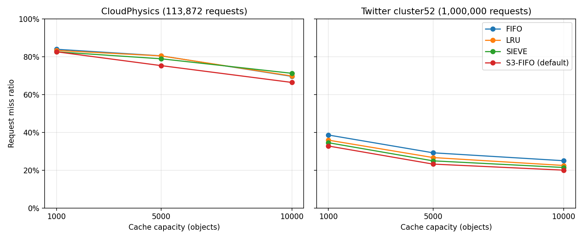
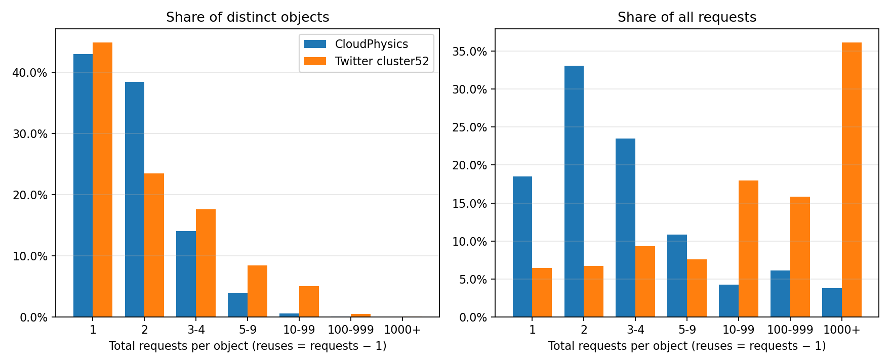

# Task 2: second public trace and workload comparison

Task 2 runs the unchanged libCacheSim FIFO, LRU, SIEVE, and default S3-FIFO
implementations on a public Twitter cluster52 sample and analyzes both samples.
The Task 1 measurements and build remain unchanged. No S3-FIFO tuning is included.

## Trace source and acquisition

The additional trace is **libCacheSim's public Twitter cluster52 CSV sample**.
It was obtained with the official Git clone during setup and is now used as the
second workload. No new dependency or separate trace download was necessary.

- Repository: <https://github.com/1a1a11a/libCacheSim>
- Pinned commit: `40fb623af3793fbe5736bda9a35488d0f366ef6e`
- [Exact source file](https://github.com/1a1a11a/libCacheSim/blob/40fb623af3793fbe5736bda9a35488d0f366ef6e/data/twitter_cluster52.csv)
- [Raw download](https://raw.githubusercontent.com/1a1a11a/libCacheSim/40fb623af3793fbe5736bda9a35488d0f366ef6e/data/twitter_cluster52.csv)
- Local path: `vendor/libCacheSim/data/twitter_cluster52.csv`
- Size: 37,690,270 bytes; 1,000,000 requests, excluding the header.
- SHA-256: `cf4d37d041569bb30c3bc32b7b54dd40b40438c53ee72e4919acf810063d189a`

The underlying workload family is Twitter's in-memory cache traces. The
[original dataset release](https://github.com/twitter/cache-trace) describes the
production collection and its CC-BY-4.0 license. **The experiment uses
libCacheSim's four-column sample**, not the original release's seven-column
request format or its full week-long traces. We do not assume the sample's
selection/conversion procedure beyond the supplied file and pinned source.

The actual CSV header is:

```text
# time, object, size, next_access_vtime
```

Columns are timestamp, numeric object ID, object size, and next-access virtual
time. The last column is ignored; no algorithm receives future-access hints.
IDs can exceed signed 64-bit range: the simulator is explicitly configured for
numeric IDs, and the analyzer uses exact Python integers, never floats.

For an existing checkout, acquisition/verification is simply:

```bash
git -C vendor/libCacheSim rev-parse HEAD
git -C vendor/libCacheSim status --short
sha256sum vendor/libCacheSim/data/twitter_cluster52.csv
```

From a fresh project checkout, obtain the files and dependencies using the
[Task 1 setup](README.md#reproduce), including these source commands:

```bash
git clone https://github.com/1a1a11a/libCacheSim.git vendor/libCacheSim
git -C vendor/libCacheSim checkout --detach 40fb623af3793fbe5736bda9a35488d0f366ef6e
```

The runner checks both input hashes, upstream commit, and upstream cleanliness.
Missing or changed inputs fail explicitly. Both entire sample files are used
without filtering, resampling, or changing their request order.

## Reproduce the experiments and analysis

Run from the project root, using the Task 1 simulator already built:

```bash
source scripts/env.sh
python3 scripts/run_task2.py
python3 scripts/plot_task2.py
```

If the simulator needs rebuilding, run `bash scripts/build.sh` first. The source,
compiler flags, dependencies, and optional allocator limitations are documented
in the [Task 1 README](README.md).

The equivalent single Twitter simulation is:

```bash
build/bin/cachesim vendor/libCacheSim/data/twitter_cluster52.csv csv s3fifo 1000 -t 'time-col=1,obj-id-col=2,obj-size-col=3,obj-id-is-num=true,has-header=true' --ignore-obj-size 1 --num-thread 1 --warmup-sec -1 --consider-obj-metadata 0 --print-head-req 0 --output results/task2/logs/example.txt
```

Replace `s3fifo` with `fifo`, `lru`, or `sieve`, and select `1000`, `5000`, or
`10000`. The initial format smoke test used this command with output redirected
to `results/task2/logs/format-check.txt` and stdout/stderr captured in
`format-check.log`. Every actual experiment invocation is saved in
`results/task2/commands.txt`. The runner truncates each run's summary file first
because cachesim otherwise appends.

All capacities are **objects**, just as in Task 1. `--ignore-obj-size 1` treats
each object as size one even though the Twitter CSV contains a size column.
Both traces use empty caches, no warmup (`--warmup-sec -1`), no admission filter,
no prefetching, no sampling, no TTL, no metadata charge, and one thread. The
algorithm parameters and hashpower stay at upstream defaults. S3-FIFO receives
no `--eviction-params`; its defaults remain 10% small FIFO, 90% main FIFO,
ghost-size ratio 0.90, and promotion threshold 2.

We compare equal absolute object capacities. Their working-set fractions differ:

| Objects | CloudPhysics: capacity / 48,974 IDs | Twitter: capacity / 143,542 IDs |
| ---: | ---: | ---: |
| 1,000 | 2.04% | 0.70% |
| 5,000 | 10.21% | 3.48% |
| 10,000 | 20.42% | 6.97% |

This is not an equal-working-set-fraction or equal-total-RAM comparison.
Ghost history and policy metadata are not charged to the advertised capacity.

## Actual measured request miss ratios

These values come directly from successful simulator runs. The CLI prints four
decimal places; we preserve that precision and do not infer exact miss counts.
The runner checks every exit status, capacity, algorithm name, and request count.

| Trace | Objects | FIFO | LRU | SIEVE | Default S3-FIFO |
| --- | ---: | ---: | ---: | ---: | ---: |
| CloudPhysics | 1,000 | 0.8388 | 0.8327 | 0.8253 | 0.8255 |
| CloudPhysics | 5,000 | 0.8042 | 0.8038 | 0.7886 | 0.7525 |
| CloudPhysics | 10,000 | 0.6956 | 0.6976 | 0.7118 | 0.6636 |
| Twitter cluster52 | 1,000 | 0.3858 | 0.3587 | 0.3451 | 0.3277 |
| Twitter cluster52 | 5,000 | 0.2919 | 0.2668 | 0.2494 | 0.2322 |
| Twitter cluster52 | 10,000 | 0.2500 | 0.2249 | 0.2143 | 0.2002 |

CloudPhysics rows reuse the actual Task 1 CSV after checking its provenance and
raw summaries. They were not remeasured or estimated for this task. New Twitter
measurements are in `results/task2/twitter_baseline.csv`; all 24 rows are in
`results/task2/comparison.csv`.



## Workload analysis

A one-time object has exactly one request **within the supplied sample**; it may
have other accesses outside that observation window. For an object accessed
`k` times, total request frequency is `k` and reuse frequency is `k - 1`.

| Measured statistic | CloudPhysics | Twitter cluster52 |
| --- | ---: | ---: |
| Total requests | 113,872 | 1,000,000 |
| Unique objects | 48,974 | 143,542 |
| One-time objects | 21,049 | 64,516 |
| One-time objects / unique objects | 42.98% | 44.95% |
| Requests to one-time objects / all requests | 18.48% | 6.45% |
| Mean requests per object | 2.3252 | 6.9666 |
| Median requests per object | 2 | 2 |
| Maximum requests to one object | 1,630 | 59,080 |
| Requests to top 1% of objects by frequency | 15.42% | 57.01% |
| Median gap between consecutive requests to the same ID | 10,036 requests | 101 requests |
| Compulsory miss lower bound: unique objects / requests | 43.01% | 14.35% |

The gap is the difference in request positions, computed only for accesses with
a previous occurrence. It is **not** a distinct-object reuse/stack distance, nor
elapsed wall time. The compulsory bound assumes an empty cache, ordinary
demand loading, and no prefetching, matching this experiment. The top 1% uses
`ceil(0.01 * unique_objects)`: 490 and 1,436 objects respectively.

The exact reuse histogram is in `results/task2/reuse_frequency.csv`. Each row
records total requests per object, reuses per object, number of such objects,
and their object and request shares. `frequency_buckets.csv` groups it as below:

| Total requests per object | Reuses per object | CloudPhysics objects | Twitter objects |
| --- | --- | ---: | ---: |
| 1 | 0 | 21,049 | 64,516 |
| 2 | 1 | 18,839 | 33,662 |
| 3–4 | 2–3 | 6,886 | 25,332 |
| 5–9 | 4–8 | 1,896 | 12,099 |
| 10–99 | 9–98 | 267 | 7,227 |
| 100–999 | 99–998 | 34 | 637 |
| 1,000+ | 999+ | 3 | 69 |



The analyzer checks that histogram object counts sum to unique objects and
frequency-weighted counts sum to total requests. Unrounded statistics are saved
in `results/task2/trace_statistics.csv`.

## Interpretation and limits

Twitter has slightly more one-time objects as a fraction of unique IDs, yet
those objects consume a much smaller share of requests. Requests concentrate
on a frequently reused subset: the hottest 1% accounts for 57.01% of Twitter
requests versus 15.42% of CloudPhysics requests. Twitter's median interaccess
gap is also much shorter. These measured differences plausibly explain why a
small cache obtains substantially more hits on Twitter, even though the same
capacities cover a smaller fraction of its unique IDs. Frequency counts alone
cannot establish causality; request order and the observation window also matter.

Default S3-FIFO has the lowest measured Twitter miss ratio at all three sizes.
At 10,000 objects, its 20.02% miss ratio is 4.98 percentage points below FIFO
and 2.47 below LRU. SIEVE also consistently beats FIFO and LRU on this Twitter
sample, whereas its ranking varies on CloudPhysics. S3-FIFO's filtering and
retention of repeatedly accessed objects are consistent with the observed hot
subset, but these experiments do not isolate the effect of any individual
mechanism or parameter.

All four policies improve with capacity at these measured points. This is two
finite samples with different lengths and cold-start fractions, not a claim
about whole production datasets or all cache workloads. Results concern request
miss ratios with equal-size objects, not byte miss ratios or equal physical RAM.
Connecting lines in the plots are visual guides, not additional measurements.

## Verification and output files

All 12 Twitter cases and both trace analyses were run twice. The five generated
data CSVs were byte-for-byte identical across runs. `verification.json` records
their checksums and the checks against raw outputs. The plots were generated
and visually inspected. Upstream source and all Task 1 result files stayed
unchanged. No trace or requested algorithm was unavailable.

- `scripts/run_task2.py`: trace checks, frequency analysis, 12 upstream runs,
  and combined CSV. It imports the existing Task 1 algorithm/revision constants.
- `scripts/plot_task2.py`: comparison and frequency plots from the measured CSVs.
- `results/task2/twitter_baseline.csv`: 12 new measurements.
- `results/task2/comparison.csv`, `comparison.png`: both workloads together.
- `results/task2/trace_statistics.csv`: sample statistics.
- `results/task2/reuse_frequency.csv`: exact histogram.
- `results/task2/frequency_buckets.csv`, `reuse_frequency.png`: grouped distributions.
- `results/task2/commands.txt`, `metadata.json`, `verification.json`: commands,
  sources, hashes, configuration, and verification evidence.
- `results/task2/logs/`: raw summaries, stdout/stderr, format check, and repeat logs.

Stopped after Task 2. No S3-FIFO code or parameters were modified.
